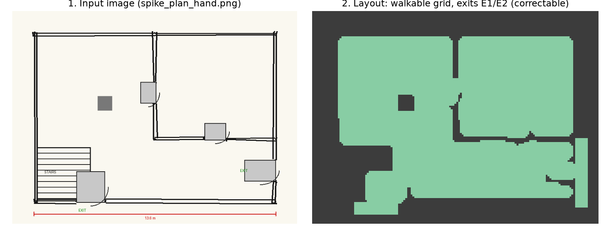
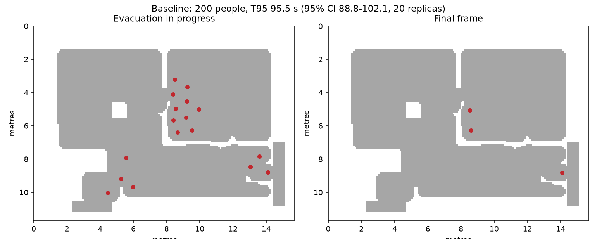
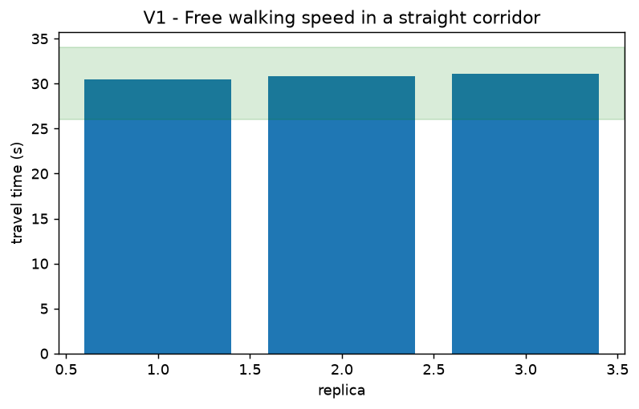
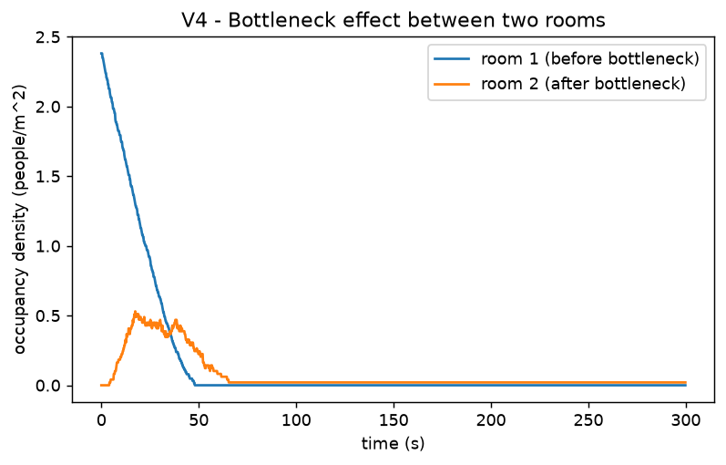
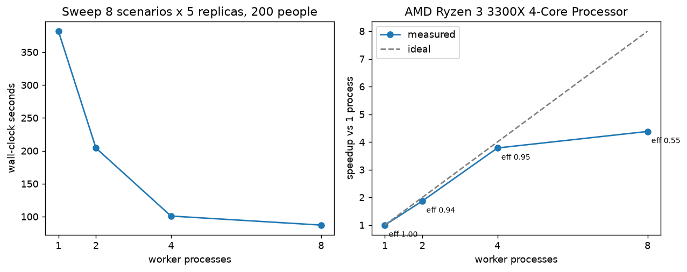

# EgressTwin

EgressTwin is a verifiable AI agent that turns an image of a building floor
plan into an evacuation digital twin, simulates it, and only recommends
changes it can prove with simulations.

An LLM never grades its own homework here: Muse Spark proposes changes, a
deterministic social-force simulator measures them across replicas, and a
deterministic verifier (plain code, no LLM) stamps the report `VERIFIED` only
when every claimed number matches the stored simulation results, the
improvement is statistically significant, and the recommendation survives an
N-1 stress test (each exit blocked in turn).

Built for the Meta Global AI Developer Hackathon (indie track, 27 Oct -
4 Nov 2026). All work in this repository is new; see [NEW_WORK.md](NEW_WORK.md).

## Screenshots

| Image to layout | Simulation |
| --- | --- |
|  |  |

The web UI (upload, correct the layout, watch the evacuation, live agent
trace, VERIFIED stamp, performance tab) is shown live in the demo video;
see `docs/submission/video_script.md`. Regenerate the two figures above
from the committed demo cache with `python scripts/make_screenshots.py`.

## How it works

1. **Perception** (`perception/`, `meta/`): Muse Spark reads the plan
   (doors, exits, scale annotation), SAM 3.1 segments with box prompts
   seeded by Spark, and OpenCV extracts walls. The result is a correctable
   `Layout` (walkable grid, obstacles, exit segments, spawn zones, scale).
   Every perception decision is recorded with confidences and warnings.
2. **Simulation** (`sim/`, `layout/`): deterministic social-force engine
   (Helbing, Farkas and Vicsek, *Nature* 407, 487-490, 2000) on a geodesic
   floor field (per-exit Dijkstra), with a precomputed wall-distance field
   and a Numba kernel. Same seed, same result. Timed live events (blocked
   exits, hazard zones) recompute only the affected floor-field slices.
3. **Agent** (`agent/`, `scenarios/`, `parallel/`): Muse Spark with tool
   calling inspects the layout, runs a baseline, proposes modifications
   (widen an exit, add an exit, remove an obstacle), compares replicas with
   confidence intervals, and must pass an N-1 stress test before
   recommending anything.
4. **Verifier** (`agent/verifier.py`): re-checks every number in the
   report against the scenario store (1% tolerance), requires Welch
   p < 0.05 plus CI separation for any claimed improvement, checks N-1
   robustness, and issues `VERIFIED`, `PARTIALLY_VERIFIED` or `FAILED`
   per claim. An honest "change nothing" report is verified as such.
5. **Web app** (`app/`): FastAPI backend and a single-page UI (vanilla JS
   and canvas, no build step) with a cached demo mode that needs no
   network and no API key.

## Real results

All numbers below come from committed artifacts; nothing is estimated.

### Real agent runs with muse-spark-1.3 (Meta Model API)

Two end-to-end runs with `META_MOCK=0`: Muse Spark read the plan
(SAM 3.1 box prompts, OpenCV walls), and Muse Spark drove the agent
through the Responses API with `previous_response_id`. Every number
below is in the saved run under `data/real_runs/` (trace with response
ids, token usage and cost per turn; report; verification; scenario
store). Each run used 200 people, a 240 s time cap and the local
sweep backend.

| | `spike_plan_hand.png` (hand-drawn style) | `test_plans/test_office.png` |
| --- | --- | --- |
| Baseline T95 (20 replicas) | 95.46 s (95% CI 88.81-102.10) | 38.28 s (95% CI 37.43-39.13) |
| Agent outcome | Add an east exit and widen E2 to 5.0 m: T95 42.18 s (95% CI 41.11-43.24); N-1 T95 97.64 / 54.58 / 94.63 s with each exit blocked | Best candidate (three added exits) reached T95 31.75 s but rose to 59.38 s with E1 blocked; the agent recommended no change |
| Verifier | **VERIFIED**, 14 of 14 checks | **VERIFIED**, 3 of 3 checks (honest no-change report, accepted after two rejected reports) |
| Model turns / scenarios | 11 / 27 | 20 / 60 (scenario budget reached) |
| Tokens in / out | 86,253 / 8,641 | 282,389 / 34,347 |
| Agent API cost | USD 0.1056 | USD 0.2288 |
| Wall time | 86 min | 90 min |

The web app's "Load demo" replays the `spike_plan_hand.png` run from
`data/demo` with its real response ids and costs, without network
access. `python scripts/demo.py --mock` still runs the whole flow
offline, with recorded perception fixtures and a scripted driver in
place of the model. Its trace is labelled `scripted` in the model
field and in the UI, never `muse-spark-1.3`.

What the real runs exposed and what was fixed (details in `PROGRESS.md`):
the API needs fully strict tool schemas; furniture drawn as filled
shapes and passages narrower than a body broke perceived layouts; and
three simulator defects froze people in place (unstable friction,
standing against a wall, static standoffs). In both runs, between 0
and 7 of 200 people per replica are still inside at the time cap.
T95 stays defined because at least 95% got out, but total and mean
egress time are censored at the cap.

### Simulator verification (RiMEA / Weidmann)

5 of 6 standard cases pass; the failing case is reported as-is and the
criterion fixed before the run was not relaxed. Full report:
[docs/verification/report.md](docs/verification/report.md).

| Case | Result |
| --- | --- |
| V1 Free walking speed, 40 m corridor (RiMEA Test 1) | PASS - 30.5-31.1 s (band 26-34 s) |
| V2 Movement around a corner (RiMEA Test 6) | PASS - 20/20 out, 0 wall crossings |
| V3 Reaction-time distribution (RiMEA Test 5) | PASS - max start error 0.82 s |
| V4 Two-room bottleneck (RiMEA Test 12) | PASS - peak density 2.38 vs 0.51 people/m^2 |
| V5 Exit choice (RiMEA Test 11) | PASS - 85/15 near/far split |
| V6 Fundamental diagram vs Weidmann (1993) | FAIL - RMSE 0.219 m/s is inside tolerance, but the two lowest density bins are not monotonic; known crush-density limitation, documented in the report |




### Sweep parallelism (measured)

The scenario sweep has two backends: `serial` (one process) and `local`
(a `ProcessPoolExecutor` on one machine; each worker process is started
with `NUMBA_NUM_THREADS=1` so processes do not oversubscribe cores). The
work unit is one (scenario, replica) pair. The local backend returns
exactly the same records as the serial one for the same seed
(`tests/test_sweep.py`). The agent uses `local` by default. There is no
MPI or multi-machine backend, and a single simulation is not
parallelised: the Numba kernel is serial.

Measured with `python scripts/bench_sweep.py` on the development machine
(AMD Ryzen 3 3300X, 4 cores / 8 threads, 16 GB RAM, Windows 11, Python
3.12), with the current simulator. The set is 8 scenarios x 5
replicas = 40 runs, 200 people, in a 20 x 12 m room. Each process
count starts a cold pool, so wall time includes process start-up
(1.4-3.2 s). Raw data is in `data/demo/bench.json` (`sweep_parallel`):

| Worker processes | Wall time | Speedup | Efficiency | Runs/min |
| --- | --- | --- | --- | --- |
| 1 | 433.7 s | 1.00 | 1.00 | 5.5 |
| 2 | 346.8 s | 1.25 | 0.63 | 6.9 |
| 4 | 187.0 s | 2.32 | 0.58 | 12.8 |
| 8 | 142.5 s | 3.04 | 0.38 | 16.8 |

All four process counts produced identical results. Scaling is well
below linear, and these measurements show two reasons. First, with 8
processes the per-run times add up to 881.5 s, against 433.7 s when
the same 40 runs execute one at a time, so each run is about 2x slower
when 8 share 4 physical cores. Second, the runs are uneven (8.2 s to
64.1 s at 8 processes): the 4 runs that keep one person inside until
the 300 s cap are the longest and set a floor on wall time. The 2-process
efficiency (0.63) is lower than these two effects explain; it was
not investigated further.



An earlier run of the same benchmark (commit `c129e61`: 381.8 / 204.3 /
100.9 / 87.2 s) predates the 2026-11-03 simulator fixes. In that version
people froze in place, so every run behaved differently, and it is
superseded.

Earlier single-process measurements from the same machine, also from
before those fixes, in a small 12 x 6 m bench room (`data/demo/bench.json`,
`scaling` and `throughput`): one run with 30 people took 1.75 s, with
100 people 4.45 s, and with 300 people 36.26 s. A serial sweep of 4
scenarios x 3 replicas (12 runs, 40 people) took 34.82 s, or 20.7
runs/min.

### Tests and API cost

- Test suite: 83 passed (`pytest`), `ruff check` clean. The 6 web-app
  tests need loopback sockets and run outside restricted sandboxes,
  as in CI.
- Total project API spend: USD 0.5391 in the logged ledgers (69 real
  calls: 19 in the perception spike, 50 through the production client,
  of which USD 0.3344 are the two real agent runs above). About USD
  0.59 all-in, counting probes that bypassed the ledgers (recorded in
  `PROGRESS.md`). Budget guard:
  `META_BUDGET_USD` (default 60) raises `BudgetExceeded`. Detail:
  [docs/cost_report.md](docs/cost_report.md).

## How to run it

### Online demo

https://huggingface.co/spaces/ManuelSanabria/egresstwin replays the
recorded real `spike_plan_hand.png` run in the browser. You get the
layout, the baseline simulation, the agent trace with real response ids
and costs, the VERIFIED report and the benchmark figures. It is a
static export of the app's demo-only mode, made with
`scripts/deploy_space.py`: no server, no API key and no API calls.
Uploading, simulating and optimizing need a local install.

The same demo-only app also runs as a container, served on port 7860.
Every request that would write anything is refused:

```bash
docker build -t egresstwin-demo .
docker run -p 7860:7860 egresstwin-demo
```

The image was not built on the development machine, which has no Docker,
and it is not hosted: Hugging Face requires a PRO plan for Docker Spaces
on free hardware, and returned 402 for this account.

### Mock mode (no network, no API key, no cost)

```bash
python -m venv .venv
.venv/Scripts/activate        # Windows; use source .venv/bin/activate on Linux/macOS
pip install -e ".[dev]"
set META_MOCK=1               # Windows cmd; use export META_MOCK=1 on Linux/macOS
pytest
python scripts/demo.py --mock
```

With `uv`:

```bash
uv venv
uv pip install -e ".[dev]"
uv run pytest
uv run python scripts/demo.py --mock
```

### Web app

```bash
.venv/Scripts/python.exe -m uvicorn egresstwin.app.api:app --app-dir src --port 8077
```

Open http://127.0.0.1:8077 in a browser: upload a plan, correct the
layout on the image, watch the evacuation, run the agent and read its
verified report. The "Load demo" button replays a complete cached run
from `data/demo` (perception layout, simulation, agent trace with a
VERIFIED stamp, benchmark figures) with no network and no API key.
Rebuild that cache with `python scripts/build_demo_cache.py`.

### Real API use

Copy `.env.example` to `.env`, set `MODEL_API_KEY`, set `META_MOCK=0`,
and run `python scripts/smoke_meta.py`. Every charged call is logged to
`runs/costs.jsonl` and the `META_BUDGET_USD` cap raises `BudgetExceeded`.

### Verification suite

```bash
python scripts/run_verification.py   # regenerates docs/verification/ and figures
```

## Simulator parameters

Deterministic social-force evacuation simulator: `layout/` holds the
`Layout` model (walkable grid serialised to `.npz`, obstacles, exits,
spawn zones) and its validation; `sim/` holds the geodesic floor field
(per-exit Dijkstra), the precomputed wall-distance field, the Numba
social-force kernel (pure NumPy reference in `sim/reference.py` for
tests), the engine (`run(layout, scenario, seed) -> SimResult`) and
metrics (total/T95/mean egress time, flow per exit, peak density,
time above a density threshold, hotspots).

```bash
python scripts/run_example.py   # 30 x 20 m room, 2 exits, 1000 people
```

Model and parameters follow Helbing, D., Farkas, I. and Vicsek, T.,
"Simulating dynamical features of escape panic", *Nature* 407,
487-490 (2000), doi:10.1038/35035023 (preprint arXiv:cond-mat/0009448),
verified against the paper text:

| Parameter | Value | Source in the paper |
| --- | --- | --- |
| Mass m | 80 kg | "a mass of m_i = 80 kg" |
| Relaxation time tau | 0.5 s | "acceleration time tau_i = 0.5 s" |
| Interaction strength A | 2000 N | "A_i = 2 x 10^3 N" |
| Interaction range B | 0.08 m | "B_i = 0.08 m" |
| Body force k | 1.2e5 kg/s^2 | "k = 1.2 x 10^5 kg/s^2" |
| Sliding friction kappa | 2.4e5 kg/(m s) | "kappa = 2.4 x 10^5 kg/(m s)" |
| Pedestrian diameter | uniform 0.5-0.7 m (radius 0.25-0.35 m) | "diameters 2r_i in [0.5 m, 0.7 m]" |

Desired speeds are drawn from a normal distribution with mean
1.34 m/s and sd 0.26 m/s (clipped to 0.4-2.5 m/s). This distribution
is the conventional normal-walking choice adopted by this project; it
is not from the 2000 paper, which uses scenario desired speeds of
about 0.6 m/s (relaxed), 1.0 m/s (normal) and 1.5 m/s (nervous).

Integration is semi-implicit Euler at dt = 0.01 s with 5 force
substeps per step (the stiff contact spring is unstable at 0.01 s in
dense overlap) and a per-agent speed cap of 1.3 x desired speed.
Three numerical and behavioural additions go beyond the 2000 paper.
Each was added after real runs showed people freezing in place
(`sim/social_force.py`, `sim/engine.py`):

1. Sliding friction kappa x overlap is capped at m / (2 dt). Above that
   value, the explicit step reversed the tangential velocity on every
   substep.
2. Within 0.3 m of body contact with a wall, the desired direction
   drops its component into the wall, so people slide along it.
3. Anyone who moves less than 0.25 m in 2 s turns their desired
   direction by a seeded random angle of up to 90 degrees for 1 s. This
   stands in for the paper's fluctuation term, which breaks static
   standoffs.

T95 is the population percentile: people still inside count as not yet
out, so T95 is finite only when at least 95% got out.

Same seed, same result: the kernel is serial and deterministic;
parallelism lives only in the scenario sweep, which spreads
(scenario, replica) pairs over local worker processes.

## Repository map

| Path | What it is |
| --- | --- |
| `src/egresstwin/meta/` | Only access point to the Meta Model API: client with retries, disk cache, cost log, budget guard, mock mode |
| `src/egresstwin/perception/` | Image to Layout: Spark plan reader, SAM segmenter, OpenCV fallback, scale, pipeline |
| `src/egresstwin/layout/` | Layout model, validation, manual edits |
| `src/egresstwin/sim/` | Floor field, wall field, social-force kernel, engine, timed events, metrics |
| `src/egresstwin/scenarios/` | Modification specs (widen/add exit, remove obstacle) and feasibility |
| `src/egresstwin/parallel/` | Scenario sweep (serial and local process-pool backends) and result store with confidence intervals |
| `src/egresstwin/agent/` | Tool-calling optimizer loop, deterministic verifier, trace, report |
| `src/egresstwin/validation/` | RiMEA/Weidmann verification cases |
| `src/egresstwin/app/` | FastAPI backend and single-page UI |
| `scripts/demo.py` | End-to-end command-line demo (`--mock` or real API) |
| `docs/verification/` | Verification report, results and status (machine-readable) |
| `docs/submission/` | Demo video script, submission texts, final checklist |
| `data/samples/` | Bundled synthetic plans; `test_plans/` holds five extra test plans (office, classroom, restaurant, shop, apartment) generated by `scripts/make_test_plans.py` for real-mode runs |
| `data/ASSETS.md` | Origin and license of every image in the repository |

## Limitations and next steps

- A full optimization run takes 86-90 minutes on the development
  machine (Ryzen 3 3300X, 8 worker processes, 200 people). Simulation
  inside the tools accounts for almost all of that time, as the saved
  traces in `data/real_runs/` show:

  | Run | Wall time | Tool calls (simulation) | Model turns | Replica runs |
  | --- | --- | --- | --- | --- |
  | `spike_plan_hand` | 5,175 s | 5,024 s (`run_scenarios` 3,659 s, `stress_test` 1,205 s) | 150 s | 540 |
  | `test_office` | 5,407 s | 4,490 s (`stress_test` 2,674 s, `run_scenarios` 1,699 s) | 916 s | 872 |

  The model chose up to 20 replicas per scenario, the maximum the tools
  allow (all 27 scenarios on `spike_plan_hand`; 19 of 60 on
  `test_office`, the rest 12). Fewer replicas, fewer people, or faster
  simulation are the levers to shorten a run.
- The agent can only change geometry: `widen_exit`, `add_exit` and
  `remove_obstacle` (`scenarios/spec.py`). Operational actions are not
  implemented yet. Examples are staggered departure
  (`stagger_departure`) and assigning a zone to a given exit
  (`assign_zone_to_exit`).
- Parallelism within one simulation: the social-force kernel is a
  serial Numba function (`@njit`, no `prange`), so one simulation uses
  one core. Each person writes only its own force row, which leaves the
  kernel ready for a parallel loop. That loop is not implemented.
- MPI backend: not implemented. The sweep runs on one machine (`serial`
  or `local` process pool), and there is no `mpi4py` dependency.
- Floor plans are the supported input; the aerial-photo path was
  spike-tested with synthetic substitutes and is deferred (see
  `docs/spike_perception.md`).
- At crush densities the simulated door flow runs above handbook
  values with the Helbing parameters; this is the documented cause
  of the V6 verification failure and is not hidden.
- Real-mode perception (2026-11-03) produced a valid layout for 2 of
  the 7 bundled plans tried: `spike_plan_hand.png` and `test_office.png`.
  On `test_classroom.png` and `spike_plan_synth.png`, Muse Spark returned
  no exit. On `test_restaurant.png`, `test_shop.png` and
  `test_apartment.png`, part of the floor is reachable only through a
  gap narrower than 0.7 m. Those plans stop with a "needs manual
  correction" error and are not silently patched. Spark door boxes can
  also be offset by about 10-30 px, which overestimates some exit widths
  (E2 on `spike_plan_hand.png` reads 3.74 m).
- On perceived plans with 200 people, 0-7 people per replica can
  remain inside at the time cap (corners of irregular perceived
  walls). They are reported (`people_exited` in every tool result), and
  total and mean egress time are censored for those replicas.
- This tool supports decisions; it is not a safety certification.

## License

MIT. See [LICENSE](LICENSE). Asset origins and licenses:
[data/ASSETS.md](data/ASSETS.md).
