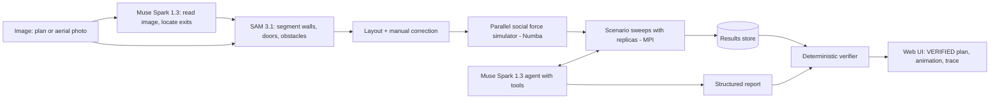

# EgressTwin

**A verifiable AI agent that turns a picture of a space into a crowd-evacuation digital twin, simulates it in parallel, and only recommends changes it can prove.**

Built for the Meta Global AI Developer Hackathon (Indie track, theme: Push the Frontier).

> Status: work in progress. Every number in this README comes from real runs. Sections marked `TBD` will be filled with measured results before submission.

## The problem

Evacuation planning for buildings and public events is usually done with static rules of thumb or expensive specialist software. Organizers of a university event, a local festival or a busy building rarely have a fast way to answer simple questions: where will people get stuck, which exit will saturate, and what single change would help most?

Language models can suggest ideas, but a crowd is a physical system. A suggestion that sounds reasonable can make congestion worse. Advice about safety should be backed by evidence, not by fluent text.

## What EgressTwin does

1. **See the space.** Upload a floor plan or an aerial photo. Muse Spark reads the image and locates exits; SAM 3.1 segments walls, doors and obstacles into pixel-precise masks. The user reviews and corrects the result in one click.
2. **Simulate the crowd.** A social force model on a geodesic floor field runs on parallel Numba kernels.
3. **Explore many futures.** Scenario sweeps with stochastic replicas run across processes (MPI or multiprocessing), so every metric comes with a confidence interval.
4. **Optimize with an agent.** Muse Spark uses the simulator as a tool: it reads hotspots, proposes changes (widen an exit, add one, remove an obstacle, stagger departures), simulates them and stress-tests the best plan with every exit blocked in turn (N-1).
5. **Verify, deterministically.** Before anything reaches the user, a verifier written in plain code checks every claim in the agent's report against the stored simulation results, tests statistical significance and confirms the plan survives the N-1 test. Only then is a recommendation marked `VERIFIED`.

## Architecture



## How Meta models are used

| Model | Role | Why this model |
|---|---|---|
| Muse Spark 1.3 | Image understanding of the plan, structured output, and the tool-calling optimization agent | Trained for agentic workflows with reliable tool calling and native image perception |
| SAM 3.1 | Segmentation of walls, doors and obstacles; refinement of exits from boxes proposed by Muse Spark | Pixel-precise masks from a text or box prompt, zero-shot |
| Muse Voice Transcribe (optional) | Live events during a drill: "Exit B is blocked" | Turns a coordinator's voice into simulation events |

All models are accessed through Meta Model API.

## Results

| Case | Baseline T95 (s) | Recommended plan T95 (s) | Change | Survives N-1 | Status |
|---|---|---|---|---|---|
| TBD | TBD | TBD | TBD | TBD | TBD |

## Parallel performance

Hardware: AMD Ryzen 3 3300X (4 cores, 8 threads), 16 GB RAM. CPU only.

| Benchmark | Result |
|---|---|
| Speedup, Numba parallel vs NumPy reference | TBD |
| Strong scaling, 2,000 agents, 1 to 8 threads | TBD |
| Sweep throughput, scenarios per minute, 1 to 4 processes | TBD |

Figures: `docs/figures/`.

## Simulation model

Social force model after Helbing, Farkas and Vicsek (Nature, 2000), with a geodesic floor field for navigation and a precomputed wall distance field. Parameters and their sources are listed in `docs/model.md` (TBD).

## Built during the hackathon

All code in this repository was written between October 27 and November 4, 2026. See [NEW_WORK.md](NEW_WORK.md) for the full disclosure, including the course project that inspired the idea.

## Run it

```bash
git clone <repo-url>
cd egresstwin
cp .env.example .env        # add your MODEL_API_KEY
pip install -e ".[dev]"
python scripts/demo.py --mock   # full flow, no network
python scripts/demo.py          # real flow with Meta Model API
```

## Limitations and responsible use

EgressTwin is a decision-support and exploration tool. It is not a certified fire or life-safety engineering tool and must not replace professional assessment or local regulations. Simulated behavior is a simplification of real human behavior.

## License

MIT
