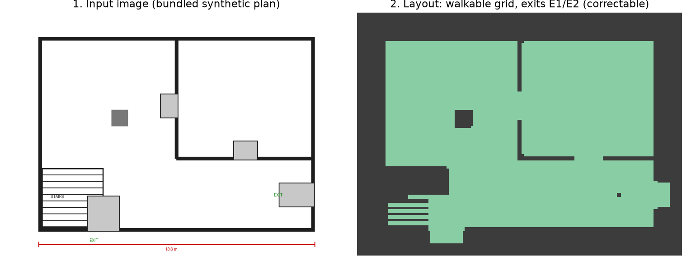
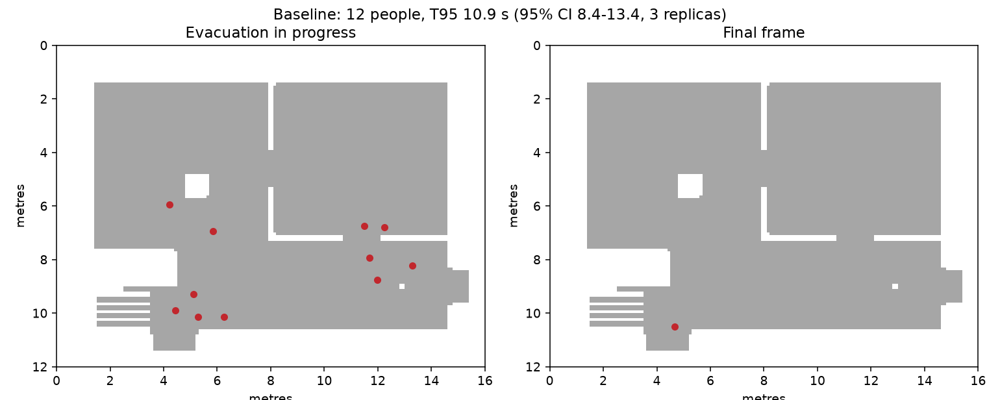
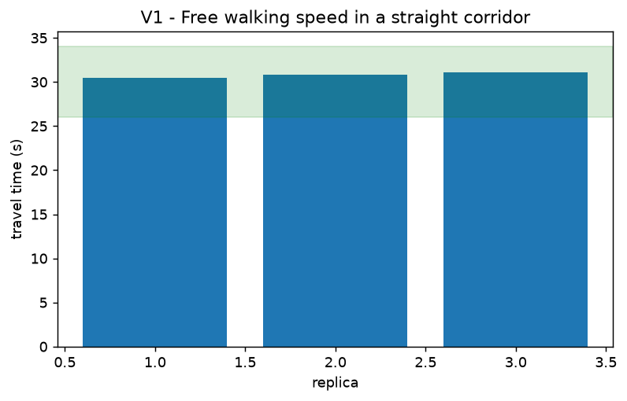
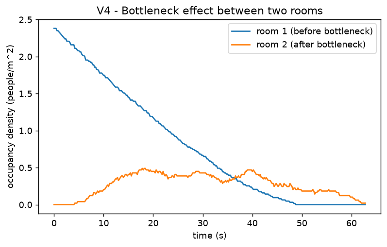
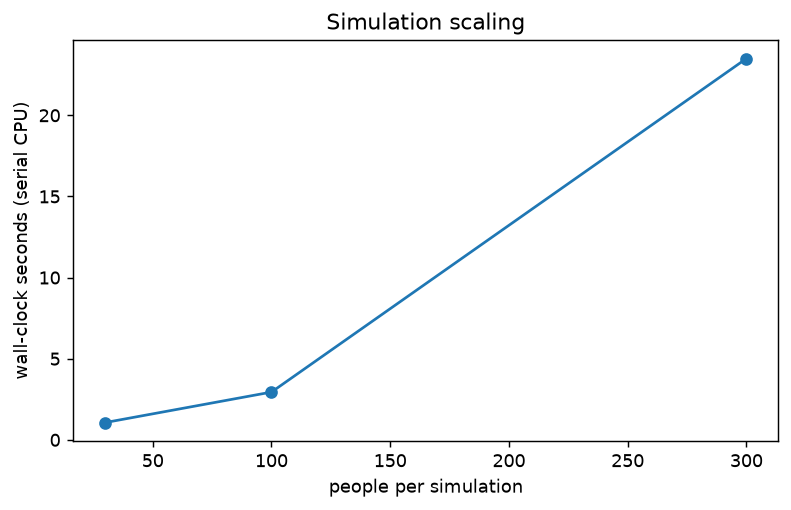
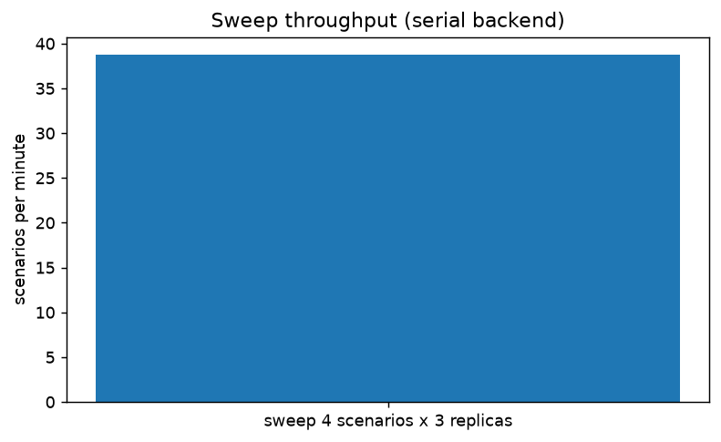

# EgressTwin

EgressTwin is a verifiable AI agent that turns an image of a space (a building
floor plan or an aerial photo of an open space) into an evacuation digital
twin, simulates it, and only recommends changes it can prove with simulations.

An LLM never grades its own homework here: Muse Spark proposes changes, a
deterministic social-force simulator measures them across replicas, and a
deterministic verifier (plain code, no LLM) stamps the report `VERIFIED` only
when every claimed number matches the stored simulation results, the
improvement is statistically significant, and the recommendation survives an
N-1 stress test (each exit blocked in turn).

Built for the Meta Global AI Developer Hackathon (indie track, 27 Oct -
4 Nov 2026). All work in this repository is new; see [NEW_WORK.md](NEW_WORK.md).

## Screenshots

| Image to layout | Simulation |
| --- | --- |
|  |  |

The web UI (upload, correct the layout, watch the evacuation, live agent
trace, VERIFIED stamp, performance tab) is shown live in the demo video;
see `docs/submission/video_script.md`. Regenerate the two figures above
from the committed demo cache with `python scripts/make_screenshots.py`.

## How it works

1. **Perception** (`perception/`, `meta/`): Muse Spark reads the plan
   (doors, exits, scale annotation), SAM 3.1 segments with box prompts
   seeded by Spark, and OpenCV extracts walls. The result is a correctable
   `Layout` (walkable grid, obstacles, exit segments, spawn zones, scale).
   Every perception decision is recorded with confidences and warnings.
2. **Simulation** (`sim/`, `layout/`): deterministic social-force engine
   (Helbing, Farkas and Vicsek, *Nature* 407, 487-490, 2000) on a geodesic
   floor field (per-exit Dijkstra), with a precomputed wall-distance field
   and a Numba kernel. Same seed, same result. Timed live events (blocked
   exits, hazard zones) recompute only the affected floor-field slices.
3. **Agent** (`agent/`, `scenarios/`, `parallel/`): Muse Spark with tool
   calling inspects the layout, runs a baseline, proposes modifications
   (widen an exit, add an exit, remove an obstacle), compares replicas with
   confidence intervals, and must pass an N-1 stress test before
   recommending anything.
4. **Verifier** (`agent/verifier.py`): re-checks every number in the
   report against the scenario store (1% tolerance), requires Welch
   p < 0.05 plus CI separation for any claimed improvement, checks N-1
   robustness, and issues `VERIFIED`, `PARTIALLY_VERIFIED` or `FAILED`
   per claim. An honest "change nothing" report is verified as such.
5. **Web app** (`app/`): FastAPI backend and a single-page UI (vanilla JS
   and canvas, no build step) with a cached demo mode that needs no
   network and no API key.

## Real results

All numbers below come from committed artifacts; nothing is estimated.

### End-to-end demo (bundled plan, mock perception, real simulation)

`python scripts/demo.py --mock` runs image, layout, baseline, agent,
N-1 stress test and verified report in about 7 s on the development
machine, with no network and no cost:

- Layout: 120 x 160 cells at 0.1 m, exits E1 (1.54 m) and E2 (1.14 m).
- Baseline (12 people, 3 replicas): T95 10.9 s (95% CI 8.4-13.4),
  total time 12.5 s, peak density 1.38 people/m^2.
- Agent: explored widening both exits; no modification beat the
  baseline with statistical significance, so the report recommends
  changing nothing and the verifier stamps it **VERIFIED**
  (2 of 2 checks). This is deliberate: the verifier rewards honesty,
  not change for its own sake.
- In the agent acceptance test (a clogged 12-person room with two
  0.5 m exits, baseline censored at 60 s), the agent widens one exit
  to 2.4 m (T95 4.6 s, everyone out), passes the N-1 stress test and
  is stamped VERIFIED with 10 of 10 claims (`tests/test_agent.py`,
  `PROGRESS.md`).

### Simulator verification (RiMEA / Weidmann)

5 of 6 standard cases pass; the failing case is reported as-is and the
criterion fixed before the run was not relaxed. Full report:
[docs/verification/report.md](docs/verification/report.md).

| Case | Result |
| --- | --- |
| V1 Free walking speed, 40 m corridor (RiMEA Test 1) | PASS - 30.5-31.1 s (band 26-34 s) |
| V2 Movement around a corner (RiMEA Test 6) | PASS - 20/20 out, 0 wall crossings |
| V3 Reaction-time distribution (RiMEA Test 5) | PASS - max start error 0.82 s |
| V4 Two-room bottleneck (RiMEA Test 12) | PASS - peak density 2.38 vs 0.53 people/m^2 |
| V5 Exit choice (RiMEA Test 11) | PASS - 85/15 near/far split |
| V6 Fundamental diagram vs Weidmann (1993) | FAIL - RMSE 0.188 m/s is inside tolerance, but the two lowest density bins are not monotonic; known crush-density limitation, documented in the report |




### Parallel / sweep performance

Measured on the development machine (Ryzen 3 3300X, 4 cores / 8 threads,
16 GB RAM, no CUDA); raw data in `data/demo/bench.json`:

| Workload | Wall time |
| --- | --- |
| 30 people, single run | 1.75 s |
| 100 people, single run | 4.45 s |
| 300 people, single run | 36.26 s |
| Sweep: 4 scenarios x 3 replicas | 34.82 s (20.7 scenarios/min) |




### Tests and API cost

- Test suite: 70 passed (`pytest`), `ruff check` clean. The 6 web-app
  tests need loopback sockets and run outside restricted sandboxes,
  as in CI.
- Total project API spend: USD 0.0658 in the logged ledgers
  (19 real calls in the perception spike), about USD 0.08 including
  exploratory probes recorded in `PROGRESS.md`. Budget guard:
  `META_BUDGET_USD` (default 60) raises `BudgetExceeded`. Detail:
  [docs/cost_report.md](docs/cost_report.md).

## How to run it

### Mock mode (no network, no API key, no cost)

```bash
python -m venv .venv
.venv/Scripts/activate        # Windows; use source .venv/bin/activate on Linux/macOS
pip install -e ".[dev]"
set META_MOCK=1               # Windows cmd; use export META_MOCK=1 on Linux/macOS
pytest
python scripts/demo.py --mock
```

With `uv`:

```bash
uv venv
uv pip install -e ".[dev]"
uv run pytest
uv run python scripts/demo.py --mock
```

### Web app

```bash
.venv/Scripts/python.exe -m uvicorn egresstwin.app.api:app --app-dir src --port 8077
```

Open http://127.0.0.1:8077 in a browser: upload a plan, correct the
layout on the image, watch the evacuation, run the agent and read its
verified report. The "Load demo" button replays a complete cached run
from `data/demo` (perception layout, simulation, agent trace with a
VERIFIED stamp, benchmark figures) with no network and no API key.
Rebuild that cache with `python scripts/build_demo_cache.py`.

### Real API use

Copy `.env.example` to `.env`, set `MODEL_API_KEY`, set `META_MOCK=0`,
and run `python scripts/smoke_meta.py`. Every charged call is logged to
`runs/costs.jsonl` and the `META_BUDGET_USD` cap raises `BudgetExceeded`.

### Verification suite

```bash
python scripts/run_verification.py   # regenerates docs/verification/ and figures
```

## Simulator parameters

Deterministic social-force evacuation simulator: `layout/` holds the
`Layout` model (walkable grid serialised to `.npz`, obstacles, exits,
spawn zones) and its validation; `sim/` holds the geodesic floor field
(per-exit Dijkstra), the precomputed wall-distance field, the Numba
social-force kernel (pure NumPy reference in `sim/reference.py` for
tests), the engine (`run(layout, scenario, seed) -> SimResult`) and
metrics (total/T95/mean egress time, flow per exit, peak density,
time above a density threshold, hotspots).

```bash
python scripts/run_example.py   # 30 x 20 m room, 2 exits, 1000 people
```

Model and parameters follow Helbing, D., Farkas, I. and Vicsek, T.,
"Simulating dynamical features of escape panic", *Nature* 407,
487-490 (2000), doi:10.1038/35035023 (preprint arXiv:cond-mat/0009448),
verified against the paper text:

| Parameter | Value | Source in the paper |
| --- | --- | --- |
| Mass m | 80 kg | "a mass of m_i = 80 kg" |
| Relaxation time tau | 0.5 s | "acceleration time tau_i = 0.5 s" |
| Interaction strength A | 2000 N | "A_i = 2 x 10^3 N" |
| Interaction range B | 0.08 m | "B_i = 0.08 m" |
| Body force k | 1.2e5 kg/s^2 | "k = 1.2 x 10^5 kg/s^2" |
| Sliding friction kappa | 2.4e5 kg/(m s) | "kappa = 2.4 x 10^5 kg/(m s)" |
| Pedestrian diameter | uniform 0.5-0.7 m (radius 0.25-0.35 m) | "diameters 2r_i in [0.5 m, 0.7 m]" |

Desired speeds are drawn from a normal distribution with mean
1.34 m/s and sd 0.26 m/s (clipped to 0.4-2.5 m/s). This distribution
is the conventional normal-walking choice adopted by this project; it
is not from the 2000 paper, which uses scenario desired speeds of
about 0.6 m/s (relaxed), 1.0 m/s (normal) and 1.5 m/s (nervous).

Integration is semi-implicit Euler at dt = 0.01 s with 5 force
substeps per step (the stiff contact spring is unstable at 0.01 s in
dense overlap) and a per-agent speed cap of 1.3 x desired speed.
Same seed, same result: the kernel is serial and deterministic;
parallelism lives in the scenario sweep (scenarios x replicas).

## Repository map

| Path | What it is |
| --- | --- |
| `src/egresstwin/meta/` | Only access point to the Meta Model API: client with retries, disk cache, cost log, budget guard, mock mode |
| `src/egresstwin/perception/` | Image to Layout: Spark plan reader, SAM segmenter, OpenCV fallback, scale, pipeline |
| `src/egresstwin/layout/` | Layout model, validation, manual edits |
| `src/egresstwin/sim/` | Floor field, wall field, social-force kernel, engine, timed events, metrics |
| `src/egresstwin/scenarios/` | Modification specs (widen/add exit, remove obstacle) and feasibility |
| `src/egresstwin/parallel/` | Scenario sweep and result store with confidence intervals |
| `src/egresstwin/agent/` | Tool-calling optimizer loop, deterministic verifier, trace, report |
| `src/egresstwin/validation/` | RiMEA/Weidmann verification cases |
| `src/egresstwin/app/` | FastAPI backend and single-page UI |
| `scripts/demo.py` | End-to-end command-line demo (`--mock` or real API) |
| `docs/verification/` | Verification report, results and status (machine-readable) |
| `docs/submission/` | Demo video script, submission texts, final checklist |
| `data/samples/` | Bundled synthetic plans; `test_plans/` holds five extra test plans (office, classroom, restaurant, shop, apartment) generated by `scripts/make_test_plans.py` for real-mode runs |
| `data/ASSETS.md` | Origin and license of every image in the repository |

## Limitations

- Floor plans are the supported input; the aerial-photo path was
  spike-tested with synthetic substitutes and is deferred (see
  `docs/spike_perception.md`).
- At crush densities the simulated door flow runs above handbook
  values with the Helbing parameters; this is the documented cause
  of the V6 verification failure and is not hidden.
- The sweep backend is serial/multiprocessing; `mpi4py` is an
  optional extra that needs MS-MPI on Windows.
- This tool supports decisions; it is not a safety certification.

## License

MIT. See [LICENSE](LICENSE). Asset origins and licenses:
[data/ASSETS.md](data/ASSETS.md).
